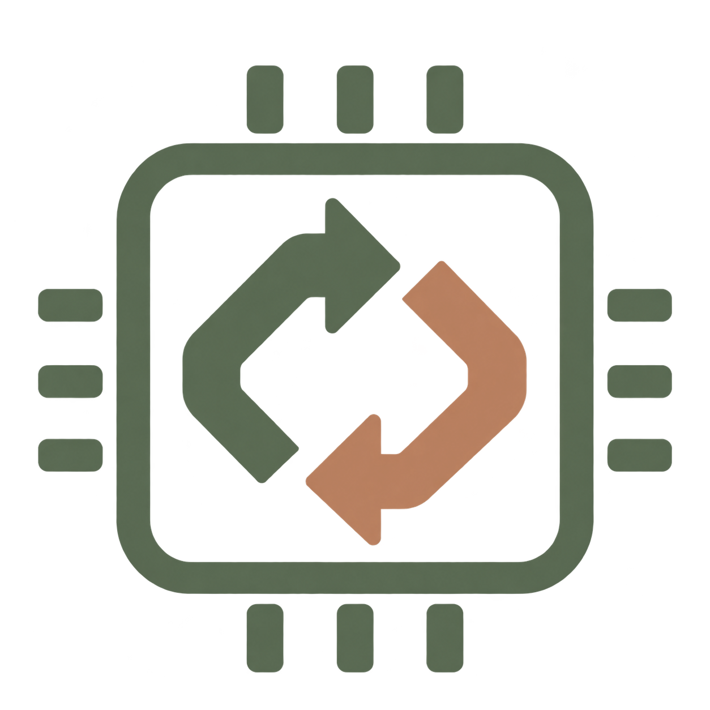
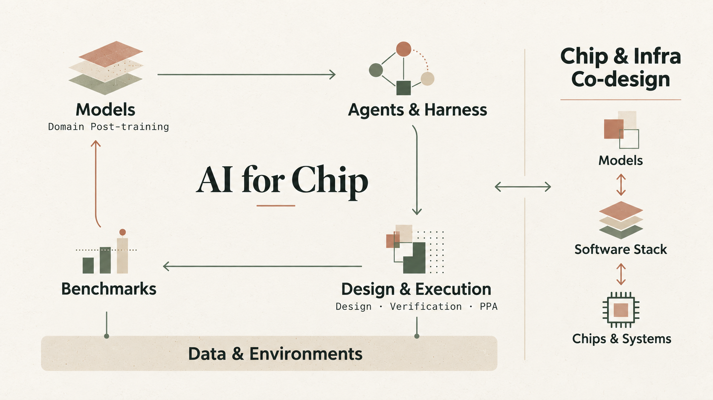

<h1 align="center"> Awesome AI4Chip</h1>

<a href="README.md">中文</a> · <strong>English</strong>

Awesome AI4Chip collects papers, open-source projects, tools and products that apply AI to chip design, covering specification understanding, RTL generation and verification, analog circuit design, synthesis and physical implementation. We organize the work by models and training methods, agents and harnesses, data, execution environments and benchmarks. The collection also covers Chip for AI and co-design across models, chips, compilers and cluster infrastructure.

**[Online docs](https://tapeo-ai.github.io/awesome-ai4chip/en/)** · [Getting started & tutorials](docs/en/tutorials.mdx) · [Environments & examples](env/README.en.md)

Updated on October 27, 2026.

## Latest

<!-- latest:start -->

- **2026-10-26** · [Cadence Maestro](https://www.cadence.com/en_US/home/company/newsroom/press-releases/pr/2026/cadence-introduces-maestro-a-domain-specialized-ai-model.html) — Introduces a family of domain models for chip and system design, trained with EDA tool feedback.
- **2026-10-22** · [Back-to-the-Future (BTTF)](https://arxiv.org/abs/2610.06790) — Updates its paper on RTL debugging with SQLite waveform data and natural-language queries.
- **2026-10-07** · [RFChipAgent](https://arxiv.org/abs/2610.10858) — Presents a multi-agent analog/RF design workflow connecting retrieval, topology selection and simulation-based optimization.
- **2026-10-04** · [VHDL-REPOBENCH](https://arxiv.org/abs/2610.05380) — Introduces repository-level VHDL evaluation focused on cross-file dependencies and hierarchical design understanding.
- **2026-10** · [Build-A-Chip-Bench](https://chipagents.ai/research/build-a-chip-bench) — Describes long-horizon evaluation from workload specifications to GDS, combining functional acceptance with PPA scoring.

<!-- latest:end -->

## Directory

- Models: [LLMs & training methods](docs/en/resources/models/llm.mdx) · [Non-LLM models](docs/en/resources/models/circuit.mdx)
- [Agents & harnesses](docs/en/resources/agents.mdx)
- [Synthesis & physical design optimization](docs/en/resources/optimization.mdx)
- [Datasets & design representations](docs/en/resources/data.mdx)
- [Tools & executable environments](docs/en/resources/tools.mdx)
- [Benchmarks & evaluation](docs/en/resources/benchmarks.mdx)
- [Commercial products & platforms](docs/en/resources/products.mdx)
- Co-design: [AI-driven design & model–hardware co-design](docs/en/resources/codesign/models-hardware.mdx) · [Custom chips & compute-in-memory](docs/en/resources/codesign/chips-cim.mdx) · [Architecture, mapping & cluster infrastructure](docs/en/resources/codesign/architecture-infra.mdx) · [Kernel agents & compiler infrastructure](docs/en/resources/codesign/kernels.mdx)
- [Surveys & practical articles](docs/en/resources/articles.mdx)

## Contributors

Thanks to everyone helping maintain this directory. Contributions of new work, corrections to links and descriptions, and executable environments are welcome.

[Open a pull request](https://github.com/tapeo-ai/awesome-ai4chip/pulls) · [Suggest an addition](https://github.com/tapeo-ai/awesome-ai4chip/issues)
